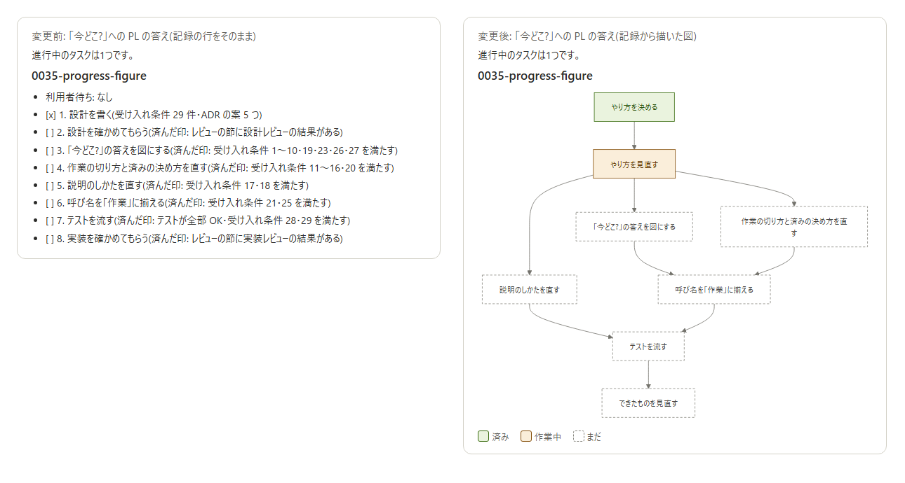

ステータス: 実装レビュー中

# 進み具合

- 利用者待ち: なし
- [x] 1. やり方を決める(受け入れ条件 29 件・ADR の案 5 つ)
- [x] 2. やり方を見直す(前: 1)(済んだ印: レビューの節に設計レビューの結果 2 件がある)
- [x] 3. 「今どこ?」の答えを図にする(前: 2)(済んだ印: 受け入れ条件 1〜10・19・23・26・27 を満たした)
- [x] 4. 作業の切り方と済みの決め方を直す(前: 2)(済んだ印: 受け入れ条件 11〜16・20 を満たした)
- [x] 5. 説明のしかたを直す(前: 2)(済んだ印: 受け入れ条件 17・18 を満たした)
- [x] 6. 呼び名を「作業」に揃える(前: 3・4)(済んだ印: 受け入れ条件 21・25 を満たした・`git grep 段階` が 0 件)
- [x] 7. テストを流す(前: 5・6)(済んだ印: テスト 64 件が全部 OK・受け入れ条件 28・29 を満たした)
- [ ] 8. できたものを見直す(前: 7)(済んだ印: レビューの節に実装レビューの結果がある)

# ゴール

利用者が PL に「今どこ?」と聞くと、タスクごとに、作業を箱・つながりを矢印・済み/作業中/まだを箱の色にした決まった形の図が返る。作業は利用者が確かめる単位と順で並び、画面のあるシステムでは AI が利用者と同じ画面で済みを確かめる。利用者への説明は、利用者が目にするものから始まる。そのために、task-team の skill・`draw-figure`・全体の CLAUDE.md・用語集を直す。

範囲外: `task-team-qa` の skill。LogiFee の `ops-ticket` などほかのリポジトリの skill。フックとテストのコード。install の配り方。LogiFee の PL から出た2つの案(報告を今話しているタスクだけにする・本番に書く確認を PG が利用者に直接聞く)。main へのマージ・push・`install.ps1 -Yes`(PL がする)。

# 受け入れ条件

12a7a14 からの差分で言う。行の文は、下のコードブロックのとおり(1行1規則)。

## draw-figure の SKILL.md

1. 末尾に、次の目的と目指す状態と7行がある。
   ```
   ## 目的: 利用者が、作業の進み具合を、図をひと目見て掴める

   ### 目指す状態: 進み具合の図は、いつも同じ形をしている(ADR 0035-1)

   - 作業1つを箱1つにし、前の作業から矢印を引いている。
   - 1本道の作業も、枝分かれする作業も、同じ描き方にしている。
   - 済み・作業中・まだは、箱の色で分けている。
   - 「いまここ」のような、今の位置を指す字は書いていない。
   - 箱の字は、作業の名前だけにしている。
   - 図の下に、3つの色が何かを示す見本を1行で添えている。
   - 記録の進み具合からは、作業の行を箱、`前: ` を矢印、作業の印を色にしている。
   ```
2. 1 の次(末尾)に、次の目指す状態と5行がある。
   ```
   ### 目指す状態: 同じ進み具合からは、同じ配置の図が出る(ADR 0035-2)

   - 図は、mermaid の `flowchart TD` の文で書き、配置は mermaid に任せている。
   - 会話の中では、HTML で mermaid@11 を esm.sh から読み込んで描いている。
   - 済みの箱は、`classDef` で `fill:#EAF3DE,stroke:#3B6D11,color:#27500A` にしている。
   - 作業中の箱は、`classDef` で `fill:#FAEEDA,stroke:#854F0B,color:#633806` にしている。
   - まだの箱は、`classDef` で `fill:#FFFFFF,stroke:#888780,color:#444441,stroke-dasharray:4 3` にしている。
   ```
3. 1・2 のほかの行は変わっていない。

## task-team-lead の SKILL.md

4. 目指す状態「「今どこ?」の答えは、各記録の進み具合のリストだけ(ADR 0034-1)」とその下の5行が、その位置で、次の目指す状態と6行に替わっている。
   ```
   ### 目指す状態: 「今どこ?」には、各記録の進み具合から描いた図で答えている(ADR 0035-1)

   - 進み具合を聞かれたら、進行中の各記録の進み具合を図にして出している。
   - 図は、skill `draw-figure` の進み具合の図の形で描いている。
   - 図は、タスクごとに1つ描き、タスク名を見出しにして上から並べている。
   - タスクの数と作業は覚えておかず、聞かれるたびに記録から引いている。
   - 詳しい説明は、利用者が聞いた作業についてだけしている。
   - 作業を聞かれたら、記録のその作業の行と作業の前提だけを読んで答えている。
   ```
5. 4 のほかの行は変わっていない。

## task-team-pg の SKILL.md

6. `- 進捗は、記録の進み具合の節を、言い換えずに載せている。(ADR 0034-1)` が、その位置で次の行に替わっている。ほかの行は変わっていない。
   ```
   - 進捗は、記録の進み具合を、skill `draw-figure` の進み具合の図で載せている。(ADR 0035-1)
   ```

## task-team-messaging の SKILL.md

7. 原則2 の目的が、次の行に替わっている。
   ```
   ## 目的: 利用者が、PL が出す進み具合の図だけで、各タスクの今が分かる
   ```
8. 原則2 の目指す状態と、その下の利用者待ちの4行より前が、次のとおりになっている(利用者待ちの4行は変わっていない)。
   ```
   ### 目指す状態: 記録の進み具合は、子セッションが知らせるたびに今を示している(ADR 0035-1)

   - 作業を始めるとき、その作業の印を `[/]` にしている。
   - 知らせる前に、済ませた作業の印を `[x]` にしている。
   - `[x]` にした作業は、済んだ印の括弧の中を、その場で数えた事実に書き換えている。
   ```
9. 末尾に、次の目指す状態と3行がある。
   ```
   ### 目指す状態: 画面のあるシステムでは、済みを利用者と同じ画面で確かめている(ADR 0035-4)

   - `[x]` にする前に、利用者が見るのと同じ画面を開き、済んだ印を確かめている。
   - プログラムが出す「処理しました」のような報告だけでは、`[x]` にしていない。
   - 画面を開けなければ、利用者待ちにして、利用者に画面で確かめてもらっている。
   ```
10. 7〜9 のほかの行は変わっていない。

## task-team-se の SKILL.md

11. `- 節は、進み具合 / ゴール / 受け入れ条件 / 設計 / 実装 / レビュー。(ADR 0034-1)` の末尾が `(ADR 0035-1)` に替わっている。
12. 目指す状態「進み具合の節を見れば、利用者がタスクの今と自分を待つものが分かる(ADR 0034-1)」とその下の12行が、その位置で、次の目指す状態と18行に替わっている。
    ```
    ### 目指す状態: 進み具合の節から、作業のつながりと今の状態が図に描ける(ADR 0035-1)

    - 進み具合の節は、記録を作るときに、利用者待ちの行と設計の作業だけで作っている。
    - 残りの作業は、設計を書くときに足している。
    - 1行目は `- 利用者待ち: なし`。
    - その下に、作業を `- [ ] <番号>. <作業>(前: <番号>)(済んだ印: <事実>)` の形で並べている。
    - 前には、先に済んでいなければならない作業の番号を「・」で並べている。
    - 前の作業が無い作業には、`(前: …)` を書いていない。
    - 作業の印は、まだが `[ ]`、作業中が `[/]`、済みが `[x]`。
    - 作業は、設計・設計レビュー・利用者が確かめる作業・実装レビューの順。
    - 設計の作業の名前は「やり方を決める」。
    - 設計レビューの作業の名前は「やり方を見直す」。
    - 実装レビューの作業の名前は「できたものを見直す」。
    - 設計レビューの作業は、大きな変更のときだけ置いている。
    - 作業の名前は、利用者が目にする言葉で書いている。
    - 済んだ印は、件数のような、確かめて言い切れる事実にしている。
    - 利用者がする作業は、名前の頭に「あなた: 」を付けている。
    - 手順の文書に進み具合の示し方があれば、作業はその形で書いている。
    - その形でも、前と作業中の印は、この節の書き方で足している。
    - そのときの利用者待ちの行は、ステータスの次の行に置いている。
    ```
13. 12 の次に、次の目指す状態と3行がある。
    ```
    ### 目指す状態: 作業は、利用者が確かめる単位で切れ、確かめる順に並んでいる(ADR 0035-3)

    - 作業は、利用者が確かめる単位(データの種類など)で切っている。
    - 番号は、利用者が確かめる順に振っている。
    - 1つの作業は、済んだ印1つで確かめられる大きさにしている。
    ```
14. 13 の次に、次の目指す状態と2行がある。
    ```
    ### 目指す状態: 画面のあるシステムでは、済んだ印が利用者の画面に出るもの(ADR 0035-4)

    - 済んだ印は、利用者が見る画面に出るもの(一覧の件数など)にしている。
    - その画面の名前と開き方を、設計の節に書いている。
    ```
15. 14 の次の目指す状態と2行が、次のとおりになっている(3行目は変わっていない)。
    ```
    ### 目指す状態: 利用者が SE の会話で聞いて分かった前提が、記録の作業に残っている(ADR 0034-2)

    - 利用者に作業を聞かれたら、答えで分かった前提を、設計の節の「作業の前提」に書き足している。
    - 書き足す行は、`<作業の番号>. <前提>` の形。
    ```
16. 11〜15 のほかの行は変わっていない。

## 全体の CLAUDE.md(`claude/CLAUDE.md`)

17. 原則2 の目指す状態「書く文と、自分が付ける名前…」の箇条書きの次(「返答は、1行目で結論が分かり…」の前)に、次の目指す状態と3行がある。ほかの行は変わっていない。
    ```
    ### 目指す状態: 説明は、利用者が既に目にしたものから始まっている(ADR 0035-5)

    - 説明は、利用者が実際に目にするもの(画面・答えの例・図)から始めている。
    - 利用者がまだ見ていないものを、知っている前提で話していない。
    - AI の側で使う言葉(PG・記録・済んだ印など)を、利用者が知っている前提で使っていない。
    ```

## 全体の CLAUDE.md の「なぜ」(`.claude/rules/global-claude-md.md`)

18. 原則6 の末尾に、次の目指す状態と1行がある。ほかの行は変わっていない。
    ```
    ### 目指す状態: 説明は、利用者が既に目にしたものから始まる規則になっている

    - 利用者は、AI の側の言葉から始まる説明を何度聞いても分からず、読む気をなくしかけた。
    ```

## task-team-lead の CLAUDE.md

19. `- 進み具合は、PL の文ではなく、記録の決まった形のリストで見せる形にしている。` が、その位置で次の2行に替わっている。ほかの行は変わっていない。
    ```
    - 進み具合は、PL の文でもリストでもなく、決まった形の図で見せる形にしている。
    - 利用者が、文で並んだ作業から、頭の中でつながりを組み立てずに済む形にしている。
    ```

## task-team-se の CLAUDE.md(新しいファイル)

20. `claude/skills/task-team-se/CLAUDE.md` があり、中身は次のとおり。
    ```
    # 原則1: 説明

    ## 目的: 利用者が、作業が済むたびに、何を確かめればよいかが分かる

    ### 目指す状態: 作業は、利用者が把握できる単位と順で進んでいる

    - 作業の済みは利用者に説明するので、作業の単位を説明の単位に揃える形にしている。
    ```

## 用語集

21. `docs/用語集.md` の表で、「進み具合」「段階」「済んだ印」「段階の前提」の4行が、その位置で次の7行に替わっている(「利用者待ち」の行は、その位置のまま変わっていない)。ほかの行は変わっていない。
    ```
    | 進み具合 | ファイルの記録では `# 進み具合`。ファイルでない記録では、手順の文書の進み具合の示し方で作業を書いた所と、その前の利用者待ちの行 | — | 利用者待ちの行と、作業の一覧を並べた、記録の節 |
    | 作業 | 進み具合の `- [ ] <番号>. <作業>(前: <番号>)(済んだ印: <事実>)` の1行 | — | 利用者が確かめる単位で切った、タスクのひと区切り。進み具合の図の箱1つ |
    | 前 | 作業の行の `(前: <番号>)` | — | 先に済んでいなければならない作業の番号。進み具合の図の矢印 |
    | 作業の印 | 作業の行の `[ ]`・`[/]`・`[x]` | — | 作業のまだ・作業中・済み。進み具合の図の箱の色 |
    | 済んだ印 | 作業の行の `済んだ印: ` | — | 作業が済んだと決める、確かめられる事実 |
    | 作業の前提 | 記録の設計の節の `## 作業の前提` | — | 利用者が SE の会話で聞いて分かった、作業の拠り所 |
    | 進み具合の図 | skill `draw-figure` の進み具合の図 | — | 進み具合から描く、作業を箱・前を矢印・作業の印を色にした図 |
    ```
    並びは、進み具合・作業・前・作業の印・済んだ印・利用者待ち・作業の前提・進み具合の図。

## ADR

22. `docs/adr/0035-1-progress-figure.md`・`0035-2-mermaid-flowchart.md`・`0035-3-work-by-user-check.md`・`0035-4-done-on-user-screen.md`・`0035-5-explain-from-what-user-sees.md` がある。
23. `docs/adr/0034-1-progress-checklist.md` の状態の行が `状態: 置き換え済み(0035-1)` で、ほかの行は変わっていない。

## 全体

24. `python -m unittest discover -s tests` が全部通る(どの SKILL.md の箇条書きの行も 60 字以内)。
25. `git grep -n 段階 -- claude docs/用語集.md` が何も出さない。
26. `git grep -n "ADR 0034-1" -- claude` が何も出さない。
27. 見本の図の画像 `docs/tasks/0035-progress-figure/sample-figure.png` があり、この記録の進み具合の8つの作業が箱で、前のとおりの矢印と、作業の印のとおりの色で出ている。
28. 実装のコミットの本文に、下の「コミットの本文に入れる『なぜ』」の文がある。
29. `git diff 12a7a14 --stat` に出るファイルは、1〜23・27 で挙げたファイルと、この記録と、記録のフォルダの画像だけ。

# 設計

文書だけの変更。SKILL.md がそのモジュールの仕様なので、`docs/specs/` は作らない・直さない。新しいファイルは、ADR 5つと `claude/skills/task-team-se/CLAUDE.md` だけ。

## 変更前と変更後の画面

PL が「今どこ?」に答える画面。左が今(記録の行をそのまま並べる)、右がこの変更の後(記録から描いた図)。右の図は、受け入れ条件 1・2 の決まりで、この記録の進み具合を mermaid で描いたもの(Edge で描いて撮った)。同じ形の図を会話の中(Claude デスクトップアプリ)に esm.sh から mermaid@11 を読み込んで出し、利用者が箱8つと矢印が見えると答えた(2026-11-04)。



## 読んだ ADR

書き換える行に付いた 0034-1(lead・se・pg・messaging の見出しと行)・0034-2(se の見出し。番号は変えない)と、作業の済みの確かめ方が重なる 0011-3 を読んだ。se の「手順の文書のほかの決まり(… 進み具合の示し方)」の行(0024-2)は変えないが、ファイルでない記録の進み具合に効くので、12 の「その形でも、前と作業中の印は…足している」はこれに沿う形にした。

## 提案する ADR

- `docs/adr/0035-1-progress-figure.md`: 進み具合は記録に作業のつながりと3つの状態を書き、PL はそこから決まった形の図を描いて出す。0034-1 を置き換える。
- `docs/adr/0035-2-mermaid-flowchart.md`: 進み具合の図は mermaid の `flowchart TD` で書き、配置は mermaid に任せる。
- `docs/adr/0035-3-work-by-user-check.md`: 作業は利用者が確かめる単位で切り、確かめる順に並べる。
- `docs/adr/0035-4-done-on-user-screen.md`: 画面のあるシステムでは、AI が利用者と同じ画面を開いて済みを確かめる。
- `docs/adr/0035-5-explain-from-what-user-sees.md`: 説明は利用者が目にするものから始め、AI の側の言葉を前提にしない。

番号は、目指す状態の見出しの末尾に付ける。見出しの下のほかの行と ADR が違う行(11 の se の節の行・6 の pg の行)は、行の末尾に付ける。0034-1 を付けていた所は、すべて 0035-1 に付け替える(26 で確かめる)。

## 利用者が決めたこと(SE の問いへの答え)

- 呼び名は「段階」をやめて「作業」に揃える。
- 図には、チームの中だけで進む作業(設計・設計レビュー・実装レビュー)の箱も入れ、名前は「やり方を決める」「やり方を見直す」「できたものを見直す」のように目にして分かる言葉にする。
- 箱の字は、作業の名前だけ。済んだ根拠(件数など)は、その作業を聞かれたときに話す。
- 説明の決まり(5)は、全体の CLAUDE.md に入れて、全部の会話に効かせる。

## SE が決めたこと

- 作業中の印は `[/]`(Obsidian の Tasks などで「作業中」に使われる書き方)。まだは `[ ]`、済みは `[x]` のまま。
- 色は、済みを緑・作業中を黄・まだを白にし、まだは枠を点線にする(色の見分けにくい人にも、まだの箱が分かる)。値は、会話の中の図の色の見本(緑・黄・灰)から取った。
- 図は上から下へ(`flowchart TD`)。会話の中の図は横幅が約 680px なので、横に長い1本道でも字が小さくならない向きにした。
- 「今どこ?」の答えの1行目の結論(例: 「進行中のタスクは1つです。」)と、図の前の見出しは、全体の CLAUDE.md の原則2 と `draw-figure` の今の決まりのとおり文で書く。図の中には書かない。
- 図の形の決まりは、PL と PG がどちらも読む `draw-figure` に1か所だけ置き、lead と pg からはそこを指す。

## 作業の前提

(この記録では、まだ無い。)

## 手順

| 順 | する人 | 操作 |
|---|---|---|
| 1 | PG | `claude/skills/draw-figure/SKILL.md`: 1・2 を末尾に足す |
| 2 | PG | `claude/skills/task-team-lead/SKILL.md`: 4 の置き換えをする |
| 3 | PG | `claude/skills/task-team-pg/SKILL.md`: 6 の置き換えをする |
| 4 | PG | `claude/skills/task-team-messaging/SKILL.md`: 7〜9 をする |
| 5 | PG | `claude/skills/task-team-lead/CLAUDE.md`: 19 の置き換えをする |
| 6 | PG | `docs/adr/0034-1-progress-checklist.md`: 23 の状態の行にする(設計レビューで 0035-1 が採用になった後) |
| 7 | PG | 見本の図を作る: この記録の進み具合を、1・2 の決まりで描いた HTML を記録のフォルダの外(一時フォルダ)に書き、`"C:/Program Files (x86)/Microsoft/Edge/Application/msedge.exe" --headless --disable-gpu --hide-scrollbars --virtual-time-budget=15000 --window-size=720,900 --screenshot=<png の絶対パス> <html の file:/// の URL>` で `docs/tasks/0035-progress-figure/sample-figure.png` に撮り、画像を開いて 27 を確かめる。HTML の形は、変更後の画面の図を描いたものと同じ(mermaid を `https://esm.sh/mermaid@11/dist/mermaid.esm.min.mjs` から読み、`mermaid.render` の svg を入れる) |
| 8 | PG | `claude/skills/task-team-se/SKILL.md`: 11〜15 をする |
| 9 | PG | `claude/skills/task-team-se/CLAUDE.md`: 20 のとおりに作る |
| 10 | PG | `claude/CLAUDE.md`: 17 を足す |
| 11 | PG | `.claude/rules/global-claude-md.md`: 18 を足す |
| 12 | PG | `docs/用語集.md`: 21 の置き換えをする |
| 13 | PG | 1〜12 を1つのコミットにし、本文に下の「なぜ」を入れる |
| 14 | PG | `python -m unittest discover -s tests`・25・26 の `git grep`・`git diff 12a7a14 --stat` を走らせる |

進み具合の作業との対応: 3 は手順 1〜7、4 は手順 8〜9、5 は手順 10〜11、6 は手順 12 と 25 の確かめ、7 は手順 13〜14。

## コミットの本文に入れる「なぜ」

```
利用者の「なぜ」: 人間が把握できる順で作業してほしい。利用者への説明が要る作業だから。Claude が文で喋る作業の並びを読んで、頭の中で作業のつながりの図(PERT 図)を組み立てるのは無理で、図になっていれば分かる。説明を何度聞いても分からず、読む気がなくなってきている。

task-team-lead の CLAUDE.md の理由: 進み具合は、記録の決まった形のリストで見せる → 決まった形の図で見せる(リストの文からは、利用者は作業のつながりを組み立てられなかった)。
```

## テスト一覧

文書だけの変更なので、テストは作らない。

| 確かめ方 | 受け入れ条件 |
|---|---|
| `git diff 12a7a14 -- claude/skills/draw-figure/SKILL.md` が、1・2 の足した行だけを示す | 1〜3 |
| `git diff 12a7a14 -- claude/skills/task-team-lead/SKILL.md` が、4 の置き換えだけを示す | 4・5 |
| `git diff 12a7a14 -- claude/skills/task-team-pg/SKILL.md` が、6 の置き換えだけを示す | 6 |
| `git diff 12a7a14 -- claude/skills/task-team-messaging/SKILL.md` が、7〜9 の行だけを示す | 7〜10 |
| `git diff 12a7a14 -- claude/skills/task-team-se/` が、11〜15 の行と 20 のファイルだけを示す | 11〜16・20 |
| `git diff 12a7a14 -- claude/CLAUDE.md .claude/rules/global-claude-md.md claude/skills/task-team-lead/CLAUDE.md docs/用語集.md` が、17〜19・21 の行だけを示す | 17〜19・21 |
| `ls docs/adr/0035-*` が5つのファイルを示し、`git diff 12a7a14 -- docs/adr/0034-1-progress-checklist.md` が状態の行だけを示す | 22・23 |
| `python -m unittest discover -s tests` が OK で終わる | 24 |
| 25・26 の `git grep` が何も出さない | 25・26 |
| `sample-figure.png` を開いて見る | 27 |
| `git log -1 --format=%b` に「なぜ」の文がある | 28 |
| `git diff 12a7a14 --stat` が、29 のファイルだけを示す | 29 |

# 実装

設計の手順 1〜12 のとおりに、文書の編集・ADR 0034-1 の状態の行・見本の図を作った(手順 13 のコミットに、この記録も入れた)。

- 見本の図: [sample-figure.png](0035-progress-figure/sample-figure.png)(箱8つ・矢印9本。作業の印は 1〜6 が済み、7 が作業中、8 がまだ。Edge で mermaid@11 を esm.sh から読み込んで撮った)。
- `python -m unittest discover -s tests`: 64 件 OK(どの SKILL.md の箇条書きも 60 字以内)。
- `git grep -n 段階 -- claude docs/用語集.md`: 0 件。`git grep -n "ADR 0034-1" -- claude`: 0 件。
- lint のコマンドは、このリポジトリの CLAUDE.md に無い。
- 受け入れ条件 29 の差分の範囲は、コミット後に `git diff 12a7a14 --stat` で確かめた結果を、PL への知らせに書く。

# レビュー

## 設計レビュー

- 0035-1 は 0034-1 を丸ごと置き換えるが、決めたことに「利用者待ちの行」と「済んだ印を確かめられる事実にする」が無い。0035-1 を付けた se・messaging の利用者待ちと済んだ印の行を、決めた ADR が無くなる。0035-1 の決めたことに足す。
- 受け入れ条件 2 の「会話の中では、HTML で mermaid@11 を esm.sh から読み込んで描いている」の根拠は、Edge で描いたことだけ(ADR 0035-2 の理由 2・設計の画面の節)。会話の中の表示で esm.sh から読み込めるかを確かめ、確かめた事実を ADR 0035-2 に書く。読み込めなければ描き方を変える。
- ADR 0035-3・0035-4・0035-5 は指摘なしで採用にした。テスト一覧(文書だけの変更で確かめ方を並べる)と ADR 番号の付け方は指摘なし。

## 設計レビューの指摘への直し

- ADR 0035-1 の決めたことに、利用者待ちの行と、確かめて言い切れる事実の済んだ印を足した。
- 会話の中の図: Claude デスクトップアプリの会話の中に、mermaid@11 を esm.sh から読み込む図を出し、利用者が箱8つと矢印が見えると答えた。この事実を ADR 0035-2 の理由 2 と、設計の「変更前と変更後の画面」に書いた。描き方は変えない。
- ADR 0035-1・0035-2 を採用にした。
