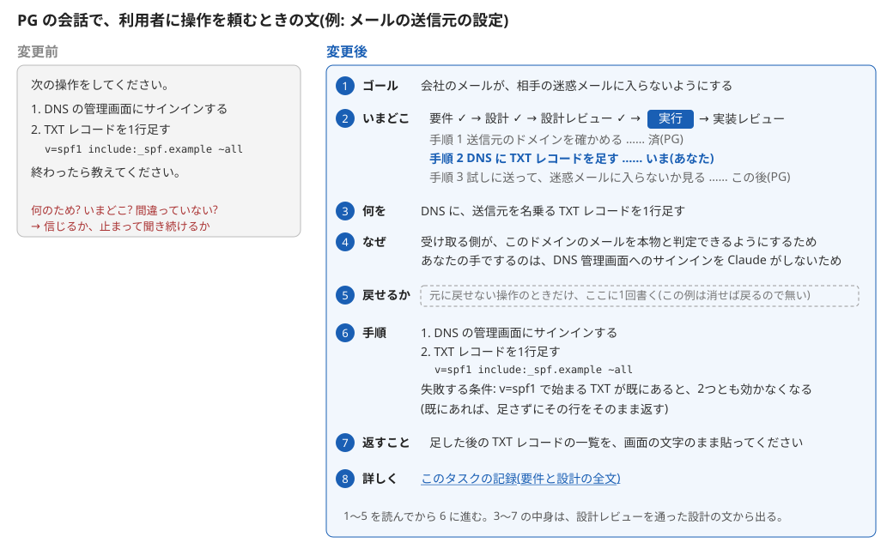
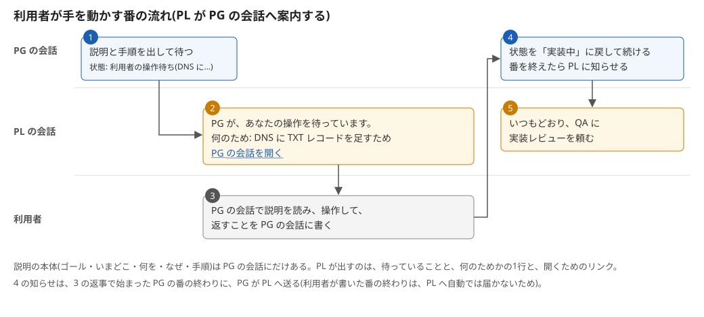
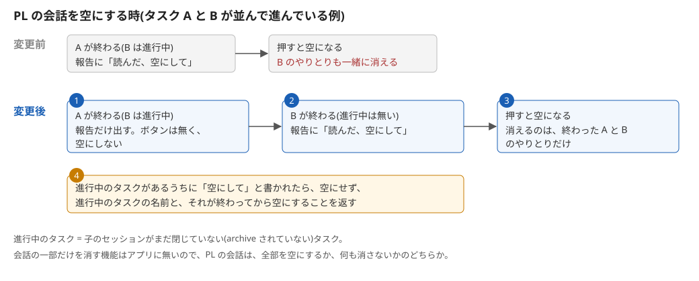

状態: 実装レビュー済み

# ゴール

task-team で、利用者(何を・なぜを決める PM の立場)が、あるタスクの実装の水準の操作を自分の手でする(PG の席に座る)とき、PM の水準の前情報しか無くても作業できるようにする。操作を頼む前に、PM の水準と実装の水準をつなぐ説明(何を・なぜ・全体のいまどこか)を先に出す。理由: その説明が無いと、言うとおりにやるか、何をしているのか・大丈夫かを聞き続けるかの2択になるから。

あわせて、PL の会話を空にするのは、終わったタスクがあっても、ほかに進行中のタスクがあるうちはしない。進行中のタスクが無くなったときにだけ、空にする。理由: 空にすると、終わっていないタスクのやりとりも一緒に消えるから(会話の一部だけを消す機能はアプリに無い)。

# 仕様

### 操作を頼む前の説明



- 1 ゴール: このタスクのゴールを1行で書く。利用者は、何のためのタスクかをここで知る。
- 2 いまどこ: チームの流れ(要件 → 設計 → 設計レビュー → 実行 → 実装レビュー)のどこかを1行で書き、その下に、手順ごとに済み・いま・この後と、する人(PG かあなた)を並べる。
- 3 何を: この操作で何を変えるかを1行で書く。
- 4 なぜ: その操作が 1 のゴールにどうつながるかと、PG ではなく利用者の手でする理由を書く。PM の水準(何を・なぜ)と実装の水準(この操作)は、ここでつながる。
- 5 戻せるか: 元に戻せない操作のときだけ、そう1回書く。戻せる操作では、この行は無い。
- 6 手順: 番号付きの手順と、そのとおりにやっても失敗する条件を書く。
- 7 返すこと: 終わったら利用者が PG に何を書いて返すかを書く。
- 8 詳しく: このタスクの記録へのリンクを付ける。要件と設計の全文を読みたいときに開く。
- 1〜5 は手順より前に出る。利用者は、PM の水準の前情報しか無くても、手を動かす前に、何を・なぜ・いまどこかを読める。
- 3〜7 の中身は、設計レビューを通った設計の文から出る。PG がその場で考えた理由は入らない。

### PL が PG の会話へ案内する



- 1 PG は、上の説明と手順を出して利用者を待つ。記録の状態は「利用者の操作待ち(操作の一言)」になる。
- 2 PL は、PG が待っていることと、何のためか(状態の括弧の中の一言)と、PG の会話へのリンクを出す。説明の本体は PL には無い。
- 3 利用者は、リンクから PG の会話を開き、説明を読んで操作し、返すことを PG の会話に書く。
- 4 PG は、状態を「実装中」に戻して手順を続ける。番を終えたら PL に知らせる。利用者の返事で始まった PG の番の終わりは、PL を自動では動かさないため。
- 5 PL は、いつもどおり QA に実装レビューを頼む。

### PL の会話を空にする時



- 1 タスクが終わっても、ほかに進行中のタスク(子のセッションがまだ閉じていないタスク)があれば、完了報告だけを出す。「読んだ、空にして」のボタンは付けず、空にしない。
- 2 終わったタスクのほかに進行中のタスクが無いときだけ、完了報告に「読んだ、空にして」のボタンを付ける。
- 3 利用者がボタンを押したら、PL の会話を空にする。消えるのは、終わったタスクのやりとりだけ。
- 4 進行中のタスクがあるうちに利用者が「空にして」と書いたら、空にせず、進行中のタスクの名前と、それが終わってから空にすることを返す。

# 要件

## ゴール

task-team の4つの skill と README に、利用者が手を動かす番の説明(SE が元を書き、QA が見て、PG が出し、PL が案内する)と、PL の会話を空にする時の直しが入っていて、テストが通る。

## 範囲外

- PG が自分でする外部のシステムの操作の、直前の確かめ(今の規則のまま)。
- SE が要件と設計のために利用者に問うとき(AskUserQuestion)の説明。
- 会話の一部だけを消すこと(アプリに機能が無い)。
- main へのマージ・push・`install.ps1 -Yes`(PL がする)。
- フックとテストのコードを変えること。

## 受け入れ条件

1. `task-team-se` に、目指す状態「利用者がする操作は、頼むときの説明の元が設計に書いてある」と、その下の4行がある。
2. `task-team-pg` の読むものの行に、記録の冒頭の「ゴール」の節が入っている。
3. `task-team-pg` に、目指す状態「利用者は、手を動かす前に、何を・なぜ・全体のいまどこかを分かっている」と、その下の10行がある。
4. `task-team-qa` の設計レビューの見ている点に、利用者がする操作の1行がある。
5. `task-team-lead` に、目指す状態「利用者は、PG に呼ばれたことと何のためかを、PL の会話で知っている」と、その下の2行がある。
6. `task-team-lead` の空にする規則が、進行中のタスクが無いときだけボタンを付け、あるうちは空にしない形になっている。
7. README の「セッションの役割分割」の節に、利用者が手を動かす番の箇条があり、PL の会話を空にする箇条が進行中のタスクが無いときだけ空にする形になっている。
8. どの SKILL.md の箇条書きの行も 60 字以内(`python -m unittest discover -s tests` が通る)。
9. コミットメッセージの本文に、利用者の言葉2つがそのままある。

# 設計

## 決めたこと(利用者の決定)

- 「全体のいまどこか」は、このタスクの手順の済み・いま・この後と、チームの流れ(要件 → 設計 → 設計レビュー → 実行 → 実装レビュー。SE → QA → PG → QA の番を、利用者に通じる言葉で書いたもの)のどこか。ほかのタスクの中での位置は出さない。
- 説明の本体は PG の会話に出し、PL は PG の会話へのリンクと何のためかの1行で案内する。
- 足す目指す状態の文は次の3つ(利用者が合意した文):
  - PG: 「利用者は、手を動かす前に、何を・なぜ・全体のいまどこかを分かっている」
  - SE: 「利用者がする操作は、頼むときの説明の元が設計に書いてある」
  - PL: 「利用者は、PG に呼ばれたことと何のためかを、PL の会話で知っている」
- PL の会話は、進行中のタスクが全部終わってから空にする。会話の一部だけを消す機能はアプリに無いため、タスクごとに PL を分ける案ではなくこちらにした。

## しくみ

- 説明の「なぜ」は、SE が設計の手順に操作ごとに書き、QA が設計レビューで見る。PG はその文を使う。PG がその場で理由を考えない。
- PG は、利用者に頼むとき、記録の「状態」を `利用者の操作待ち(<操作の一言>)` にする。PL は子の知らせで「状態」を読み(今の規則)、これを見て案内を出す。
- 利用者の返事で始まった PG の番が終わっても、PL には知らせが届くだけで、PL は動き出さない(アプリの説明: 利用者が動かした番の知らせは、PL の次の番まで待つ)。そこで PG が PL に `SendMessage` で知らせる。`SendMessage` を受けたセッションは動き出す。
- 進行中のタスクは、今の規則のとおり、`list_sessions`(linked)と各記録の「状態」で分かる。

## 変えるファイル

すべて既にあるファイル。新しいファイルは作らない。用語集・ADR・`docs/概要.md` はこのリポジトリに無く、作らない(README の「〜の意図」の節が決定の置き場)。新しい語「利用者の操作待ち」(状態の値)は、README と PG・PL の skill で同じ字で使う。

足す行の字数は、フックの数え方(`rule_length`)で数えて 19〜47 字。すべて 60 字以内。

### `claude/skills/task-team-se/SKILL.md`

「### 目指す状態: コードの無いタスクも、同じ節と順で回っている」の箇条書きの後(「### 目指す状態: 利用者が、仕様の節の図を見て、…」の前)に、次の節を挟む:

```
### 目指す状態: 利用者がする操作は、頼むときの説明の元が設計に書いてある

- 設計の手順には、操作ごとに、する人(PG か利用者)を書いている。
- 利用者がする操作には、何を・ゴールにどうつながるか・なぜ利用者の手でかを書いている。
- 同じ操作に、手順・失敗する条件・終わったら利用者が返すことを書いている。
- 元に戻せない操作には、そう書いている。
```

### `claude/skills/task-team-pg/SKILL.md`

1. 「- 読むのは、記録の「設計」「レビュー(設計)」の節と、設計が指すファイル。」の行を、次の行に替える(同じ位置):

```
- 読むのは、記録の冒頭の「ゴール」と「設計」「レビュー(設計)」の節と、設計が指すファイル。
```

2. 「### 目指す状態: 外部のシステムの設定は、利用者が直前に認めた操作でだけ変わっている」の箇条書きの後(「### 目指す状態: 受け入れ条件ごとに、…」の前)に、次の節を挟む:

```
### 目指す状態: 利用者は、手を動かす前に、何を・なぜ・全体のいまどこかを分かっている

- 操作を頼む文は、ゴール・いまどこ・何を・なぜ・戻せるか・手順・返すことの順。
- ゴールは、記録の冒頭の「ゴール」の節を1行にしている。
- いまどこの1行目は、要件→設計→設計レビュー→実行→実装レビューの、いまの位置。
- 2行目からは、手順ごとに、済み・いま・この後と、する人(PG かあなた)。
- 何を・なぜ・手順・返すことは、設計の文から書いている。
- 戻せるかは、元に戻せない操作のときだけ1回書いている。
- 文の末尾に、記録へのリンクを付けている。
- 頼むとき、「状態」を「利用者の操作待ち(<操作の一言>)」にしている。
- 返事が来たら、「状態」を「実装中」に戻している。
- 利用者の返事で始まった番を終えるときは、PL に `SendMessage` で知らせている。
```

### `claude/skills/task-team-qa/SKILL.md`

「- CLAUDE.md 原則1(安全)に触れる操作が無いか。」の次の行に足す:

```
- 利用者がする操作に、ゴールへのつながり・利用者の手でする理由・失敗する条件・返すことがあるか。
```

### `claude/skills/task-team-lead/SKILL.md`

1. 「### 目指す状態: 終わったタスクは、リポジトリに残り、チームは閉じている」の前(「### 目指す状態: QA の「止める」指摘は、…」の箇条書きの後)に、次の節を挟む:

```
### 目指す状態: 利用者は、PG に呼ばれたことと何のためかを、PL の会話で知っている

- 「状態」が「利用者の操作待ち」になったら、PG の会話へのリンクを出している。
- リンクには、「状態」の括弧の中の一言を、何のためかとして添えている。
```

2. 「- 報告は `wrap_up` に「読んだ、空にして」のボタンを付けて出し、その turn では空にしない。」の行を、次の2行に替える(同じ位置):

```
- 報告は `wrap_up` で出し、その turn では空にしない。
- 「読んだ、空にして」のボタンは、進行中のタスクが無いときだけ報告に付けている。
```

3. 「- 利用者がボタンを押すか空にしてと書いた turn で、`clear_session` self で空にしている。」の次の行に足す:

```
- 進行中のタスクがあるうちは空にせず、その名前と、終わってから空にすることを返している。
```

### `README.md`(「## セッションの役割分割(PL / SE / PG / QA)の意図」の節)

1. 「- **外部のシステムの設定を変える操作は、PG が実行の直前に利用者に確かめる**。…」の箇条(「通った手順にある操作だけ」で終わる)の後に、次の箇条を足す:

```
- **利用者が手を動かす番は、頼む前に、何を・なぜ・全体のいまどこかを説明する**。利用者は PM として
  何を・なぜを決めるが、実装の水準の前情報は持っていない。PM の水準と実装の水準をつなぐ説明が無いと、
  言うとおりにやるか、何をしているのか・大丈夫かを聞き続けるかの2択になる。SE が設計の手順に、
  操作ごとにする人を書き、利用者がする操作には、ゴールにどうつながるか・なぜ利用者の手でか・
  失敗する条件・終わったら返すことを書き、QA が設計レビューで見る。PG は頼むとき、記録の冒頭のゴール・
  いまどこ(チームの流れと手順の位置)・何を・なぜを手順より先に出し、「状態」を「利用者の操作待ち」にする。
  PL はそれを見て、PG の会話へのリンクと何のためかの1行を出す。利用者の返事で始まった PG の番の
  終わりは PL を動かさないので、PG が SendMessage で PL に知らせる
```

2. 「- **PL は、タスクを閉じるたびに、利用者が完了報告を読んでから会話を空にする**(/clear)。」で始まる箇条のうち、1行目から「ほかのタスクが進行中でも消えない。」の行までの5行を、次の6行に替える(「圧縮(要約)は、…」の行からあとはそのまま):

```
- **PL は、進行中のタスクが無くなってから、利用者が完了報告を読んだあとに会話を空にする**(/clear)。
  子の知らせで進んだタスクは利用者が見ていない間に閉じるので、自動で空にすると、何が起きたかを
  後から知る術が無くなる。ほかに進行中のタスクがあるうちは空にしない。会話の一部だけを消す機能は
  アプリに無く、空にすると終わっていないタスクのやりとりも一緒に消えるため。進行中のタスクが無い
  ときの完了報告にだけ「読んだ、空にして」のボタンを付け、押されたら空にする。進行中のタスクは、
  起こしたセッションの一覧と、記録の「状態」の行で分かる。
```

## コミット

1コミットにする: 上の5ファイルと、この記録の「実装」の節。

- 件名: `利用者が手を動かす番の前に説明を出し、PL の会話は進行中のタスクが無くなってから空にする`
- 本文の1段落目に、利用者の言葉をそのまま書く:「私は、この仕組みにおいて、このタスクやって、あのタスクやって、と言うPMの立場ですよね。そのときに、あるタスクにおいて、実際に手を動かすPGの席にいきなり座らされても、何をやっているのかわけがわからない、という話をしている。(その時に、文字通りただ手を動かすだけで一切の問題がないなら、このタスクはなかったことにしてよいけれど)」
- 本文の2段落目に、利用者の言葉をそのまま書く:「あるタスクが完了したときの、PLセッションのクリアであるが、もしできるのなら、『終わったタスクだけのクリア』という形にしたい。終わっていないタスクのメッセージもろとも消えるのが嫌だ」
- 本文の3段落目に、PL の会話の理由の経緯を書く:「前の理由: 進捗はセッションの一覧と記録にあるので、ほかのタスクが進行中でも空にしてよい → 新しい理由: 空にすると終わっていないタスクのやりとりも消えるので、進行中のタスクが無くなってから空にする」
- 本文の4段落目に、上の「決めたこと(利用者の決定)」を短く書く。

フック(`ask_removable_words.py`)が足した行に語を消すよう問い返してくるが、skill の目指す状態の文は利用者が合意した文なので変えない。規則の行は、意味が変わらない語なら消してよい。消したら、この記録の「実装」の節にその行を書く。

## テスト一覧

| 確かめ方 | 受け入れ条件 |
|---|---|
| `test_どのSKILL_mdの箇条書きの行も60字以内`(既にある。`python -m unittest discover -s tests` で走る) | 8 |
| `git diff main -- claude/skills/task-team-se` を読み、上の節が上の位置にそのまま入っている | 1 |
| `git diff main -- claude/skills/task-team-pg` を読み、読むものの行の置き換えと、上の節が上の位置に入っている | 2・3 |
| `git diff main -- claude/skills/task-team-qa` が、上の1行を足しただけ | 4 |
| `git diff main -- claude/skills/task-team-lead` を読み、上の節と、空にする規則の置き換え・足した行が上の位置に入っている | 5・6 |
| `git diff main -- README.md` を読み、上の箇条の足しと置き換えが上の位置に入っている | 7 |
| `git log -1 --format=%B` に、利用者の言葉2つがそのままある | 9 |

「そのまま入っている」は、「実装」の節に書いた、フックに問われて語を消した規則の行を除いて見る。

lint のコマンドはこのリポジトリに無い。

# レビュー(設計)

「止める」0件・「直したい」3件・「任せる」2件。

指摘:

- 直したい / `claude/skills/task-team-pg/SKILL.md`: 足す2行「記録の「ゴール」の節」が、冒頭の「# ゴール」と「要件」の中の「## ゴール」のどちらか二通りに読める。要件のゴールは実装の水準の文(skill と README に入っていてテストが通る)なので、取り違えると PM の水準のゴールが出ない。冒頭の節を指す書き方にする(例:「記録の冒頭の「ゴール」の節」)。受け入れ条件 2 と README の箇条も同じ。
- 直したい / `claude/skills/task-team-pg/SKILL.md`: 「いまどこ」のチームの流れが、仕様(決まり 2 と図: 要件 → 設計 → 設計レビュー → 実行 → 実装レビュー)と、PG に足す行と「決めたこと」(SE→QA→PG→QA)とで違う。PG は skill の行で書くので、図と違う文が出る。どちらかに揃える。
- 直したい / `claude/skills/task-team-qa/SKILL.md`・`README.md`: 仕様の決まり 4 と SE に足す行にある「なぜ PG ではなく利用者の手でか」が、QA に足す行(ゴールへのつながり・失敗する条件・返すこと)と README の SE の書くものに無い。QA が見ないと、決まり 4 の後半を PG がその場で考えることになり、決まり「PG がその場で考えた理由は入らない」と合わない。QA の行と README に足す(QA の行は 60 字以内に収まる長さで)。
- 任せる / `claude/skills/task-team-pg/SKILL.md`: 仕様の決まり 2「いまの手順には「あなた」と書く」と、図の各手順の(PG)・(あなた)が、PG に足す「いまどこ」の行に無い。SE に足す行で設計に「する人」が書かれるので PG は書けるが、行に入れるかは SE に任せる。
- 任せる / `docs/tasks/user-as-worker-briefing.md`: テスト一覧の受け入れ条件 1 の行は「そのまま入っている」だが、「コミット」の節は、フックに問われた規則の行の語を消すことを認めている。実装レビューでは、「実装」の節に書かれた行を除いて「そのまま」を見る。

見た点と結果:

- 受け入れ条件がテスト名で言えるか: 1〜9 とも確かめて言い切れる文で、テスト一覧に全部の行がある。8 は既にあるテスト `test_どのSKILL_mdの箇条書きの行も60字以内` で覆う。
- 字数: 設計のコードブロックにある skill の行 20 本を `rule_length` で数え、19〜43 字(設計の記述どおり)。60 字を超える行は無い。
- 用語集と名前: このリポジトリに用語集は無い。新しい語「利用者の操作待ち」は、仕様・PG・PL・README で同じ字。目指す状態の3つの文は「決めたこと」の文と一致。
- 置き場所(`module-layout`): 新しいファイルは無く、既にある5ファイルの節の中に足す。足す位置の前後の行は、いまのファイルに実在することを確かめた(README の置き換え範囲の5行も一致)。
- CLAUDE.md 原則1(安全): 削除・force push・本番の操作は無い。会話を空にする操作は、空にする場面を今より減らす向き。main へのマージと install は範囲外で PL がする。
- 仕様の節: 3つの機能とも「### 見出し → 図の行 → 図の番号で始まる決まり」の順。図の行のほかに、実際のファイル名・コマンド・関数名・ブランチ名・テストの件数は無い。3つの図の番号と決まりの番号は合っている。
- しくみ: PG の番の終わり(PL の依頼で始まった番)で PL に知らせが届き、利用者の返事で始まった番の終わりは PG が `SendMessage` で知らせる形で、図 2 の 4 と合う。利用者の操作が2回以上ある手順でも、同じ行で「利用者の操作待ち」と知らせを繰り返せる。

## 再レビュー(1往復目、コミット b6c97d4)

「止める」0件・「直したい」0件・「任せる」2件。前の5件は全部直っている。

指摘:

- 任せる / `claude/skills/task-team-pg/SKILL.md`: 「いまどこ」の1行目が「実行」で固定。コードのあるタスクでは記録と QA の言葉が「実装」なので、同じ行の「実装レビュー」とも揃わない。コードのあるタスクでは「実装」と書くかは SE に任せる。
- 任せる / `claude/skills/task-team-se/SKILL.md`: SE に足す行「ゴールにどうつながるか」と QA に足す行「ゴールへのつながり」は、前の指摘 1 と同じく、どちらの「ゴール」か書いていない。設計を書く SE が取り違える見込みは低いので、「冒頭の」を足すかは SE に任せる。

前の指摘の確かめ:

- 1(ゴールが二通りに読める): PG の2行・受け入れ条件 2・README が「記録の冒頭の「ゴール」」になった。直っている。
- 2(チームの流れの書き方の違い): PG の行・仕様の決まり 2・「決めたこと」が「要件→設計→設計レビュー→実行→実装レビュー」に揃い、図の1行目とも合う。直っている。「決めたこと」の文は、SE→QA→PG→QA の言い換えと書き足す形で変わったが、指す流れは同じ。
- 3(利用者の手でする理由): QA の行と README の SE の書くものに入った。直っている。
- 4(「あなた」): PG の「2行目からは」の行と、仕様の決まり 2 に、手順ごとのする人(PG かあなた)が入り、図の(PG)(あなた)と合う。直っている。
- 5(「そのまま」): テスト一覧の下に、フックに問われて語を消した行を除くと書いた。直っている。

直しで変わった所の確かめ:

- PG の節の行は10行になり、受け入れ条件 3 の「10行」と合う。
- 設計のコードブロックにある skill の行 21 本を `rule_length` で数え、19〜47 字(設計の記述どおり)。60 字を超える行は無い。
- 旧い書き方(SE→QA→PG→QA を流れとして書く所)は、「決めたこと」の言い換えの説明のほかに残っていない。

# 実装

- 設計どおりに5ファイルを直した。語を消した規則の行は無い(フックの問い返しには、設計の方針どおり、設計の文のまま残した)。
- `python -m unittest discover -s tests`: 42 件 OK(受け入れ条件 8)。lint のコマンドは無い。
- 受け入れ条件 1〜7 は `git diff` を設計の文と照らして確かめた(置き換えは完全一致で1か所ずつ)。9 はコミットメッセージに利用者の言葉2つを入れた。

# レビュー(実装)

コミット b9b293d を見た。「止める」0件・「直したい」0件・「任せる」0件。

見た点と結果:

- 設計と実装の差: 設計のコードブロック9つ(SE 1・PG 2・QA 1・PL 3・README 2)が、どれも対象ファイルに1字違わず入っている(スクリプトで照合)。足した位置・置き換えた位置は、どれも設計の指す前後の行のとおり。置き換え前の行(PG の読むもの、PL の報告の行、README の5行)は残っていない。`main` との差は、この5ファイルと記録・図だけ。
- テストの覆い: 受け入れ条件 1〜7 はテスト一覧の行(差分を設計の文と照らす)で、上の照合で全部覆った。8 は下のテスト。9 は下のコミットメッセージ。
- テストと lint: 自分で `python -m unittest discover -s tests` を走らせ、42 件 OK。lint のコマンドはこのリポジトリに無い。
- コミットメッセージ(受け入れ条件 9): 件名・1段落目・2段落目が「コミット」の節の文と一致し、3段落目に経緯「前の理由 → 新しい理由」、4段落目に「決めたこと」の要約がある。1コミットに5ファイルと記録の「実装」の節が入っている。
- 語を消した行: 「実装」の節に、語を消した規則の行は無いとあり、照合でも設計の文のまま。
- 外部(DB・ネット・ファイル・時計)の分離: コードの変更が無いので対象外。
- 仕様の節と図: 3つの機能の決まり(説明の 1〜8 の順、PL の案内、空にする時の 1〜4)は、PG・PL の skill と README の行と合っている。
- 設計の再レビューで「任せる」にした2件(「実行」の固定、SE・QA の行の「ゴール」)は、設計に取り込まれていないので、実装も設計のとおり。止める理由にはしない。

